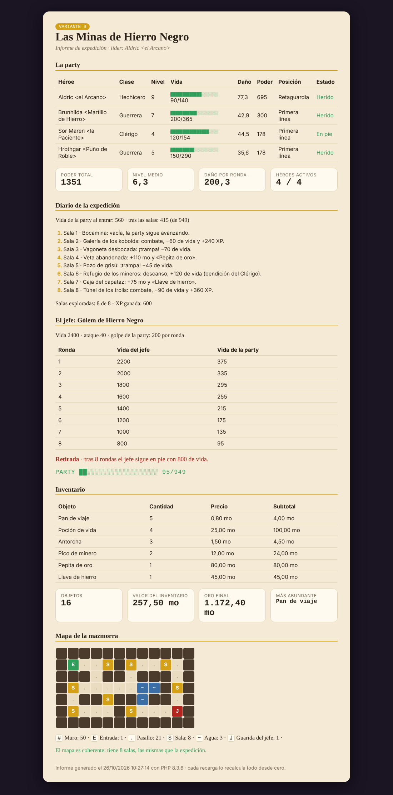
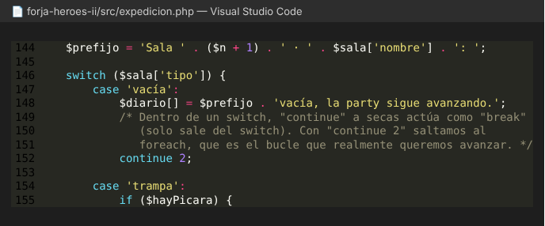

# Memoria · Tarea de refuerzo UD3 «Forja de Héroes II»

**Alumno/a:** Adrián Hermida Moreno · **Variante:** B (Las Minas de Hierro Negro) · **Fecha:** 26/10/2026

> Las capturas están en `capturas/`. La página se abre en mi Docker en `http://localhost:8080/forja-heroes-ii/src/expedicion.php`.



## 1. Comprobación de resultados

Compara TU página con la tabla de comprobación del enunciado.

| Dato | Valor esperado (enunciado) | Valor de mi página | ¿Coincide? |
|---|---|---|---|
| Poder total de la party | 1351 (nivel medio 6,3) | 1351 (nivel medio 6,3) | Sí |
| Daño por ronda | 200,3 · golpe 200 | 200,3 · golpe 200 | Sí |
| Líder | Aldric (4 héroes activos) | Aldric &lt;el Arcano&gt; (4 / 4) | Sí |
| Vida al salir de las salas | 560 · 415 (de 949) | 560 al entrar · 415 tras las salas (de 949) | Sí |
| Resultado frente al jefe (y ronda) | Retirada (8 rondas) | Retirada · tras 8 rondas el jefe sigue con 800 de vida | Sí |
| Oro final | 1.172,40 mo | 1.172,40 mo | Sí |
| Valor del inventario | 16 objetos · 257,50 mo | 16 objetos · 257,50 mo | Sí |
| Salas en el mapa | # 50 · . 21 · S 8 | # 50 · . 21 · S 8 (mapa coherente) | Sí |

También coinciden los estados (Herido · Herido · En pie · Herido), las salas exploradas (8 de 8), la XP ganada (600), la vida final de la party (95, 2 bloques) y el objeto más abundante (Pan de viaje).

Además he cambiado `VARIANTE` a `'A'` y a `'C'` para comprobar que el código no está hecho "a medida" de la B, y en las dos salen los valores de su columna de la tabla (por ejemplo Victoria en la ronda 5 y 2.260,75 mo en la A, y 3 héroes activos con Vex de líder en la C). Después lo he dejado otra vez en `'B'`. Con `error_reporting = E_ALL` no sale ningún Warning, Notice ni Deprecated en ninguna variante.

## 2. Bucles y documento resultante

Código del `foreach` que pinta la tabla de la party:


Lo que llega al navegador (Ctrl+U) de esa misma tabla:


- **¿Cuántas filas `<tr>` hay?** En el código solo hay **una** fila `<tr>` dentro del `foreach`, pero en el Ctrl+U aparecen **4 filas de héroes** (más la fila de cabecera `<th>`, que está fuera del bucle). Es porque el `foreach` se ejecuta en el servidor y repite ese trozo de HTML una vez por cada héroe del array `$party`, que tiene 4.
- **¿Aparece `endforeach` o `if`?** No. En el Ctrl+U no hay nada de PHP: ni `foreach`, ni `endforeach`, ni `if`/`else`/`endif`. PHP se ejecuta en el servidor y al navegador solo le manda el resultado (HTML). Por eso en cada fila solo aparece **una** de las dos celdas de estado (`<td class="vida">` en todas, porque en la B nadie está K.O. ni En peligro): el `if` ya ha decidido en el servidor cuál se pinta.
- Detalle curioso: en el Ctrl+U se ven las sangrías un poco descolocadas. Es porque los espacios que hay delante de las etiquetas `<?php ... ?>` también se envían como texto.
- Los nombres salen como `&lt;el Arcano&gt;` porque los paso por `htmlspecialchars()`. Si no, el navegador pensaría que `<el Arcano>` es una etiqueta y no la mostraría.

## 3. Experimento: predigo el efecto de un cambio

Añado al principio de `$salas` en `inc/datos-B.php`:

```php
['nombre' => 'Derrumbe', 'tipo' => 'combate', 'valor' => 2400],
```

1. **Predicción** (antes de recargar):
   - Es un combate, así que la party pierde `intdiv(2400, 4)` = **600** de vida. Entra con 560, así que se queda en −40 → se pone a 0.
   - Después del `switch` salta la comprobación de vida y el `break` corta el `foreach`: se explorará **1 sala de 9** (quedan 8 sin explorar).
   - Jefe: como la party no tiene vida, el `if` da **Derrota** (no llegó a la guarida) y no hay combate.
   - Mapa: ahora hay 9 salas en los datos y el mapa sigue teniendo 8 `S`, así que saldrá el **aviso de que el mapa no es coherente**.
   - Oro: no se recoge ningún tesoro ni recompensa, se queda en 987,40 mo.
2. **Resultado real:** coincide con la predicción.

   

3. **¿Qué sentencia corta el recorrido?** El `break` que está después del `switch`, dentro del `if ($vidaParty <= 0)`. Sale del `foreach` de las salas, por eso solo se ve una línea de sala y la de «La party cae en la sala 1». La **tabla de rondas no aparece** porque el combate con el jefe nunca llega a ejecutarse: entra por la rama `Derrota` del `if`, el array `$rondas` se queda vacío y en el HTML la tabla está dentro de `if (count($rondas) > 0):`.
4. He quitado la sala y los datos están como al principio (lo he comprobado volviendo a mirar la tabla de comprobación).

## 4. Experimento: match frente a switch

1. Cambio la clase de Hrothgar de `'Guerrera'` a `'Bardo'` y recargo:

   

   Salen dos cosas:
   - Un **Warning** `Undefined array key "Bardo"` en la línea del `vidaMax`, porque `MULT_VIDA` no tiene la clave `'Bardo'`.
   - Un **Fatal error** `Uncaught UnhandledMatchError` en la línea del `match` del daño. Es un error de tipo `UnhandledMatchError` (una excepción que nadie captura, por eso para el script entero y ya no se pinta la página). Se produce porque el `match` compara la clase con sus brazos (`Guerrera`, `Hechicero`, `Pícara`, `Clérigo`), ninguno es `'Bardo'` y **no tiene `default`**.
2. El `switch` de la posición le daría **'Reserva'**, porque cae en el `default`. El `switch` no falla porque si ningún `case` coincide simplemente ejecuta el `default` (y si no lo tuviera, no haría nada y seguiría). El `match` en cambio está obligado a devolver un valor, y si no encuentra ningún brazo lanza el error. (En la captura no se llega a ver «Reserva» porque el `match` del daño está antes y el script se para ahí).
3. He vuelto a poner `'Guerrera'`. En un programa real prefiero el comportamiento del **`match` sin `default`**: si llega un dato que no esperaba, es mejor que el programa falle y avise a que calcule un daño o una posición inventados sin que nadie se entere. El `default` del `switch` está bien solo cuando de verdad hay un valor por defecto que tenga sentido.

## 5. Experimento: continue dentro de switch

Así está el caso `'vacía'` en mi código:



1. Cambio `continue 2;` por `continue;` y recargo. Aparece este aviso arriba del todo (antes que el HTML, porque PHP lo detecta al compilar el fichero, no al ejecutarlo):

   `Warning: "continue" targeting switch is equivalent to "break". Did you mean to use "continue 2"? in .../expedicion.php on line 152`

   

2. **¿Qué cambia?** En mi caso, el diario y el recuento de salas **no cambian** (siguen siendo 8 de 8 y las mismas 8 líneas). Lo he comprobado comparando el HTML de las dos versiones y solo cambia el Warning. Lo que cambia es a qué bucle afecta:
   - `continue 2;` afecta al **`foreach`** (el segundo nivel contando desde dentro): salta directamente a la siguiente sala y se salta lo que hay después del `switch`.
   - `continue;` afecta al **`switch`** (el primer nivel), que no es un bucle, así que hace lo mismo que `break`: sale del `switch` y sigue con lo que hay debajo (la comprobación de si la party ha caído). Como en una sala vacía la vida no cambia, esa comprobación no hace nada y el resultado es el mismo.
   - No cambia el recuento porque yo hago `$salasExploradas++` **al principio** del `foreach`, antes del `switch`. Si lo hubiera puesto al final, con `continue 2` las salas vacías no se contarían y saldría 7 de 8.
3. Lo he dejado otra vez con `continue 2;`, que es lo correcto y no da avisos.

## 6. Uso de IA (obligatorio declararlo)

¿Has usado alguna IA? ¿Para qué? Copia una respuesta que te diera y explica si era correcta o qué tuviste que corregir.
